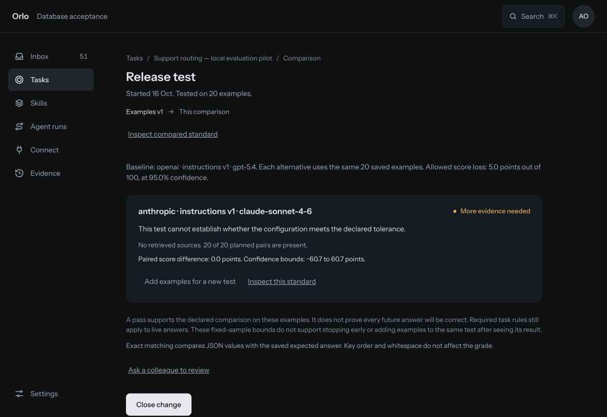

# Two models disagreed with our label on the same support ticket

An Orlo comparison returned 40 valid JSON answers. Both models matched 19 of 20 provisional references and disagreed with the same queue label. Inspecting that ticket exposed an overlap in our written policy. The next step is to clarify the policy and review the label before running another comparison.

This synthetic study ran on 16 October 2026. It uses a fictional software company's policy and AI-authored labels that have not received human review. It demonstrates an evaluation workflow; it does not measure production accuracy or identify today's best model.

## What we tested

Each ticket asks for a queue, a priority and an escalation decision. The policy covers security, access, technical and billing questions, including urgency and repeated contacts. It instructs the model not to raise priority because of customer tier or demands for urgency. The small dataset does not establish that models follow that rule in every situation.

There are 20 tickets in ten related scenario families. Fourteen are marked development. The other six, labelled regression in the original artifact, cover three different families: unclear requests, integrations and subscriptions. They provide a family-separated check, but all labels were visible and all 20 cases were evaluated together. There was no unseen holdout.

We selected GPT-5.4 and Claude Sonnet 4.6 from the models available through the local setup's direct provider connections to exercise the same workflow across two providers. This was a local integration pilot, not a survey of the latest models. Each model answered each ticket once. The exact returned model IDs and available settings are recorded in the [methods appendix](study-methods.md).

An answer matched only if all its JSON values equalled the provisional reference. Key order and whitespace did not affect the grade. No model judge, embedding grader or retrieval was used. We independently re-scored the saved answers and reproduced all 40 grades.

| Measure | GPT-5.4 | Claude Sonnet 4.6 |
|---|---:|---:|
| Answers returned | 20/20 | 20/20 |
| Valid JSON | 20/20 | 20/20 |
| Whole answers matching the reference | 19/20 | 19/20 |
| Queue matching the reference | 19/20 | 19/20 |
| Priority matching the reference | 20/20 | 20/20 |
| Escalation matching the reference | 20/20 | 20/20 |

Both models combined used 21,920 tokens, at an estimated model cost of **about $0.07**. That is Orlo's estimate from recorded token usage and pricing, not a provider invoice.

## Why the shared disagreement matters

Case `support-008` asks how to rotate API keys during routine maintenance. There is no active compromise or blocked workflow. Our provisional reference routes it to Security. Both models routed it to Technical, while matching the reference's normal priority and no-escalation decision.

The original policy contains both of these clauses:

> security for security incidents or security questions

> technical for product/API/integration issues and product how-to questions

It orders active incidents and blockages, but does not explicitly settle which clause wins for a routine security-related API how-to. Case `support-011`, a CSV-export question, is labelled Technical. The rationale for `support-008` explains why the ticket is not an incident, but does not explain why Security takes precedence over Technical.

That makes this a policy-and-label review question. The saved answer disagrees with our reference; that alone does not establish that the model made a domain error. Nor does agreement between two models establish that the label is wrong.

We preserved the original policy, labels and answers, documented the overlap, and prepared a separate draft with explicit precedence and additional boundary cases. That draft still needs human review and a new comparison. We have not measured an improvement.

## What the comparison could tell us

It could not distinguish the models on these cases. There were **zero tickets where one model matched the reference and the other did not**. Equal observed scores do not establish equivalence on future tickets, and this small pilot supplied no observed advantage for either model.

Orlo reported **More evidence needed**. The task also required at least 100 examples before release; this pilot had 20. Neither model was released from this experiment. Adding near-duplicate tickets just to reach the count would not establish broader coverage.

## What a team can take from this

An evaluation can reveal an assumption in the task definition as well as a model failure. Here, the useful output was an inspectable disagreement: the original ticket, both model answers, the provisional label and the policy clauses behind it.

The next decision is concrete: have a domain owner resolve the queue overlap, review the affected references, and test different cases under the revised policy. Keep the earlier result so the reason for the change remains visible.

Follow [the tutorial](tutorial.md), inspect [the cases](cases.jsonl), or re-score [the saved answers](study-results.json) independently. The [dataset card](dataset-card.md) documents coverage limits, and the [methods appendix](study-methods.md) records the experiment and reproducibility limits.

Published as a historical workflow study. The data and article are CC BY 4.0; tools are MIT licensed. Reference labels remain unreviewed. The later 500-case dataset and its results are separate from this 20-case experiment.
