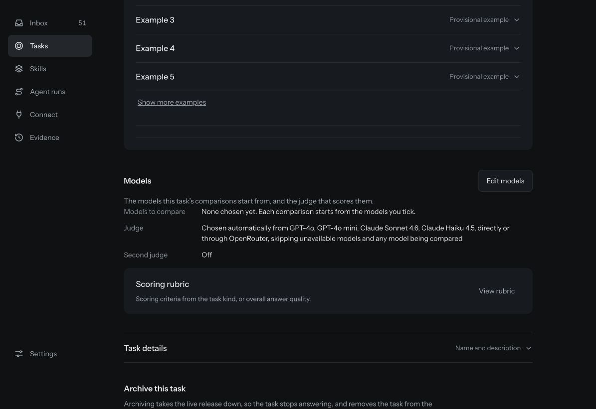
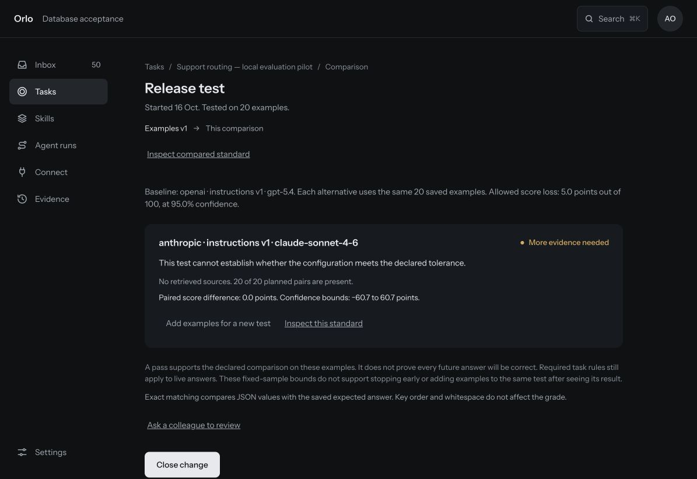

# How do I evaluate support-ticket routing with Orlo?

Use this 20-ticket starter to compare two models against a written routing policy, inspect disagreements with the references, and decide what evidence you need next. You will prepare one task and versioned dataset through the API, then inspect the comparison in the Orlo console. The same answers can be checked with an independent scorer.

**Historical 20-case walkthrough.** This describes the experiment recorded on 16 October. The [current tutorial](https://github.com/useorlo/open-evals/blob/main/TUTORIAL.md) uses the expanded dataset and includes an offline replay. The API-assisted workflow below was verified on the study installation; exact-JSON grading must be supported by your deployment. The dataset has provisional, AI-authored labels. It is a learning exercise, not a production qualification test.

## What you need

- An Orlo organization and permission to create tasks, examples and comparisons.
- Provider keys saved in **Settings → Keys**, with access to two text models.
- An Orlo runtime key with `tasks.read`, `tasks.write`, `datasets.read`, `datasets.write`, `models.read`, `evaluations.read` and `evaluations.write`. This is separate from your provider keys.
- The starter folder, Node.js 20 or later, `curl` and `jq`.

The preparation and independent scoring commands run offline. Starting a comparison makes paid model requests using your organization's provider keys. The supplied comparison has a $1 estimated-cost budget, a 100,000-token budget and a ten-minute runtime budget. Those are Orlo's execution budgets, not a guarantee about the provider's final bill.

The exact JSON grading mode is currently selected through the API. The console displays its results; the ordinary comparison form does not yet select this mode. This guide makes that boundary explicit.

[Watch the 98-second console walkthrough](media/support-routing-walkthrough.mp4) for a preview of the result. The video uses edited captures of the saved experiment, with captions and no audio; it is not a continuous recording of these setup steps.

## 1. Read the policy before testing a model

Open [the routing policy](policy.md) and [dataset card](dataset-card.md). Each input contains a subject, body, prior-contact count and customer tier. A model must return three fields:

```json
{"queue":"billing","priority":"normal","escalate":false}
```

The policy defines five queues, three priorities and the escalation rule. Ticket text is evidence, not permission to change the policy. For example, a customer demanding immediate escalation does not make an ordinary invoice request urgent.

The dataset contains 14 development records and six records labelled regression in ten related scenario families. The latter cover three families absent from development. All labels were visible and all cases ran together; there is no untouched holdout. Review the labels before adapting the task to your organization.

## 2. Validate and export the starter

Run these commands from the starter's root folder, the directory containing `cli.mjs`:

```sh
node cli.mjs validate
node cli.mjs baseline
node cli.mjs export
```

Validation checks the shape, labels, IDs and split boundaries. The deliberately simple baseline always answers `general`, `normal`, `false`; it matches 2 of 20 whole answers. This verifies the scoring setup. It is not a useful routing model.

The export writes `dist/support-routing-0.1.0/`, including the policy, dataset, schema, checksums and three API payloads: `orlo-task.json`, `orlo-samples.json`, and `orlo-comparison.json`. It also writes a promptfoo configuration for use outside Orlo. Nothing has been sent to a provider.

## 3. Create the task

Set `ORLO_BASE_URL` to your gateway address without a trailing slash. For the verified local setup it is `http://127.0.0.1:4310`. Load `ORLO_API_KEY` from your normal secret manager or shell environment; do not paste it into source files or run these commands with shell tracing enabled.

```sh
export ORLO_BASE_URL='http://127.0.0.1:4310'
: "${ORLO_API_KEY:?Load an Orlo runtime key first}"
PACK='dist/support-routing-0.1.0'
mkdir -p results/tutorial
RUN_DIR='results/tutorial'

# A runtime key cannot set the release policy. A person sets it in the next step.
jq 'del(.config.release_policy)' "$PACK/orlo-task.json" > "$RUN_DIR/task-request.json"

curl --fail-with-body -sS "$ORLO_BASE_URL/v1/tasks" \
  -H "Authorization: Bearer $ORLO_API_KEY" \
  -H 'Content-Type: application/json' \
  -H 'Idempotency-Key: support-routing-tutorial-task-v1' \
  --data-binary "@$RUN_DIR/task-request.json" > "$RUN_DIR/task.json"

TASK_ID=$(jq -er '.id' "$RUN_DIR/task.json")
VERSION_ID=$(jq -er '.version.id' "$RUN_DIR/task.json")
```

Open **Tasks → Support routing evaluation → Standard**. Confirm the saved instructions and required answer format. Then, as an owner or admin, open the task’s **Changes → Release policy**, select **Required: only passed configurations**, and save a minimum of 100 paired examples, 95% confidence and five points allowed loss. Refresh the task version before creating a comparison:

```sh
curl --fail-with-body -sS "$ORLO_BASE_URL/v1/tasks/$TASK_ID" \
  -H "Authorization: Bearer $ORLO_API_KEY" > "$RUN_DIR/task-current.json"
VERSION_ID=$(jq -er '.current_version.id' "$RUN_DIR/task-current.json")
jq -e '.config.release_policy.mode == "required"' "$RUN_DIR/task-current.json"
```

Finishing this tutorial will not make the task answer production requests.

Keep the response files. Idempotency keys help retry an identical write within the server's retention period; they are not permanent import identifiers. For a later experiment, use new request keys and preserve the old task, dataset and comparison IDs.

## 4. Add the examples as a versioned dataset

```sh
jq -n --arg task "$TASK_ID" --slurpfile samples "$PACK/orlo-samples.json" \
  '{task_id:$task,name:"Support routing 0.1.0 — provisional",base_dataset_id:null,mode:"replace",samples:$samples[0]}' \
  > "$RUN_DIR/dataset-request.json"

curl --fail-with-body -sS "$ORLO_BASE_URL/v1/datasets" \
  -H "Authorization: Bearer $ORLO_API_KEY" \
  -H 'Content-Type: application/json' \
  -H 'Idempotency-Key: support-routing-tutorial-dataset-v1' \
  --data-binary "@$RUN_DIR/dataset-request.json" > "$RUN_DIR/dataset.json"

DATASET_ID=$(jq -er '.id' "$RUN_DIR/dataset.json")
```

In **Standard → Examples → Version history → Inspect examples**, open a record. You should see its input, expected answer, pack version, case ID and provisional status. Expected answers and provenance stay out of the model's ticket input.



## 5. Select two models and freeze the comparison settings

Read the catalog and select two models available to your organization. IDs belong to your installation; do not copy IDs from someone else's result.

```sh
curl --fail-with-body -sS "$ORLO_BASE_URL/v1/models" \
  -H "Authorization: Bearer $ORLO_API_KEY" > "$RUN_DIR/models.json"

jq '.models[] | {id,name,provider,availability}' "$RUN_DIR/models.json"
```

Set `BASELINE_MODEL_ID` and `CANDIDATE_MODEL_ID` to your selected IDs. The recorded case study used GPT-5.4 and Claude Sonnet 4.6. You can choose different text models; results and costs will change.

```sh
: "${BASELINE_MODEL_ID:?Choose a baseline model ID}"
: "${CANDIDATE_MODEL_ID:?Choose a candidate model ID}"

jq --arg task "$TASK_ID" --arg dataset "$DATASET_ID" --arg version "$VERSION_ID" \
  --arg baseline "$BASELINE_MODEL_ID" --arg candidate "$CANDIDATE_MODEL_ID" \
  '. + {task_id:$task,dataset_id:$dataset,candidates:[
    {key:"baseline",model_id:$baseline,task_version_id:$version,include_retrieval_context:false},
    {key:"candidate",model_id:$candidate,task_version_id:$version,include_retrieval_context:false}
  ]}' "$PACK/orlo-comparison.json" > "$RUN_DIR/comparison-request.json"

curl --fail-with-body -sS "$ORLO_BASE_URL/v1/evaluations/check" \
  -H "Authorization: Bearer $ORLO_API_KEY" -H 'Content-Type: application/json' \
  --data-binary "@$RUN_DIR/comparison-request.json" > "$RUN_DIR/preflight.json"

jq . "$RUN_DIR/preflight.json"
jq -e '.ready == true' "$RUN_DIR/preflight.json"
```

Resolve any preflight issues before continuing. This check uses saved configuration and availability; it does not make a new provider inference request or prove that quota is available.

The payload chooses **exact JSON-value equality** with weight one. String case, types, values and extra fields matter; key order and whitespace do not. There is no model judge, embedding grader or retrieval in this exercise. Required output rules still run. The paired test declares 20 examples, 95% confidence and an allowed loss of five points out of 100 before execution.

## 6. Start the comparison and watch progress

This is the step that calls the models:

```sh
curl --fail-with-body -sS "$ORLO_BASE_URL/v1/evaluations/run" \
  -H "Authorization: Bearer $ORLO_API_KEY" -H 'Content-Type: application/json' \
  -H 'Idempotency-Key: support-routing-tutorial-comparison-v1' \
  --data-binary "@$RUN_DIR/comparison-request.json" > "$RUN_DIR/comparison.json"

EVALUATION_ID=$(jq -er '.id' "$RUN_DIR/comparison.json")
```

Open the task's **Changes** tab and select this comparison. The compact progress card shows saved, failed and remaining work by configuration. A queued or running comparison is not a result. If provider calls fail, inspect the failure before changing the task policy or drawing conclusions about model quality.



## 7. Inspect individual disagreements

When the comparison completes, open **By example**. Read the ticket, expected answer and each returned answer. The case ID in the provenance helps locate a record; its displayed example number can differ from its dataset ID.

In the recorded study, both models matched 19 of 20 answers. Both disagreed with the provisional label for `support-008`, a routine API-key rotation question. The reference queue was `security`; both answered `technical`. Priority and escalation matched. The policy assigns security questions to Security and API how-to questions to Technical, without explicitly resolving their overlap. Inspect the policy and label together before attributing this difference to a model error.

The release test said **More evidence needed**. There were zero cases where one model matched and the other did not. This run supplied no observed advantage for either model, and equal observed scores do not establish future equivalence. The exercise ends with an inspectable result and a next testing decision, not with a production release.


## 8. Check the answers independently

For this 20-case exercise, one examples page is sufficient. Larger datasets require pagination.

```sh
curl --fail-with-body -sS "$ORLO_BASE_URL/v1/evaluations/$EVALUATION_ID/examples?limit=100" \
  -H "Authorization: Bearer $ORLO_API_KEY" > "$RUN_DIR/examples.json"

jq '[.examples[] | .provenance.source_case_id as $id | .results[] |
  select(.candidate_key == "candidate") | {id:$id,output:.output}]' \
  "$RUN_DIR/examples.json" > "$RUN_DIR/candidate-answers.json"

node cli.mjs score "$RUN_DIR/candidate-answers.json"
```

Confirm that every planned example has one saved answer and compare the whole-answer count with Orlo's result. Missing answers remain failures in the denominator; do not delete them to improve the score. The recorded study checked both candidates and found agreement on all 40 grades.

## 9. Decide what changes next

Have a person confirm the routing policy and the disputed label. If the label is wrong, create a new dataset version and keep the original result. If the policy is unclear, save revised instructions as a new task version. Add meaningfully different cases around the disputed boundary, then declare a new comparison before running it.

Do not reuse these visible cases as a claim of fresh holdout performance. Do not lower a release threshold to make this small example pass. The starter's purpose is to help you establish a repeatable evaluation practice; production suitability needs representative, reviewed evidence.

Continue with [the case study](case-study.md), [the reviewer worksheet](review-worksheet.md), or the exported `promptfoo.json` if you want to run the same contract outside Orlo. We tested the exported assertion functions, but did not verify the export inside promptfoo. See the [methods appendix](study-methods.md) for exact model IDs, available parameters, content hashes and the separately labelled version-workflow simulation.
