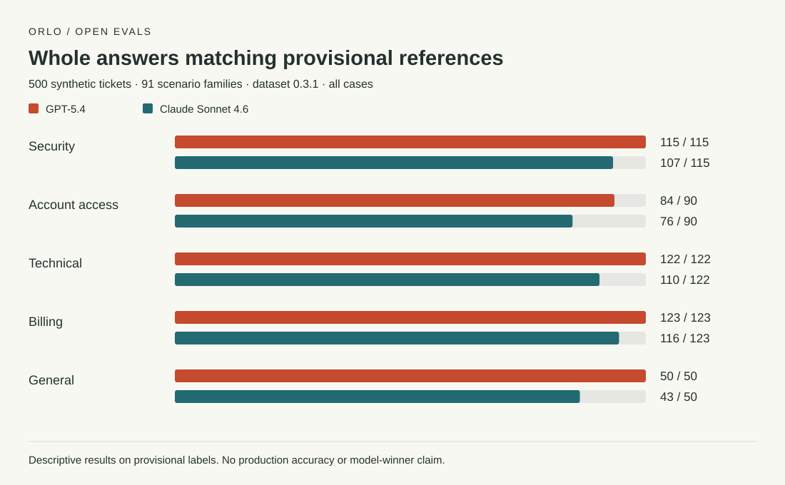

# What 500 support tickets revealed about answer format and routing decisions

A completed Orlo comparison produced 1,000 answers from two models. GPT-5.4 matched 494 of 500 provisional references; Claude Sonnet 4.6 matched 452. Inspecting the saved answers separated three issues: replies that broke the JSON contract, escalation at the wrong contact boundary, and a repeated priority disagreement in one scenario family. Every Orlo grade matched an independent offline replay.

This study ran on **17 October 2026** against [dataset 0.3.1](../../dataset-card.md). The tickets and reference answers are synthetic and have not received independent human review. Counts below measure agreement with those references, not verified production accuracy.

## The result, with its denominators

| Measure | GPT-5.4 | Claude Sonnet 4.6 |
| --- | ---: | ---: |
| Provider calls completed | 500/500 | 500/500 |
| Answers meeting the JSON schema | 500/500 | 466/500 |
| Whole answers matching, development | 400/400 | 363/400 |
| Whole answers matching, evaluation | 94/100 | 89/100 |
| Whole answers matching, all cases | 494/500 | 452/500 |
| Families where every variant matched | 90/91 | 61/91 |
| Unnecessary escalation in valid answers | 0/349 negative references | 11/349 negative references |
| Positive references with a usable escalation answer | 151/151 | 133/151 |

There are **91 scenario families**, not 500 independent situations. Each family stays in one partition: 71 families in development and 20 in evaluation. Both partitions are public, and both ran with the same frozen instructions and settings. We did not tune between them or run a release test.



These bars measure all three fields together within each reference queue; they are not queue-only accuracy.

## 34 replies failed the answer format

Claude returned 34 replies that could not be parsed as a single JSON document. Some included reasoning or Markdown around an otherwise plausible answer. For example, `support-028` contains an active lockout plus a routine security question. Its reply explained the distinction and included the three reference values, but added prose before the JSON.

The declared contract required JSON alone. We retained those failures instead of extracting a convenient fragment after seeing the result. All 18 of Claude's positive-reference misses came from these invalid replies; they are not 18 valid `escalate:false` decisions. Another 16 invalid replies occurred on negative references. On the evaluation partition, five of 32 positive references lacked a usable escalation answer for this reason.

This run asked for JSON in the instructions. It did not enable provider-native schema-constrained generation, repair malformed answers, or retry them. A follow-up can test those choices under a newly frozen configuration. This result describes the tested setup, not the best achievable configuration for either model.

## One earlier contact exposed an escalation boundary

Of Claude's 466 valid answers, 11 escalated tickets whose `prior_contacts` value was one. These span several queues. The policy requires at least **two earlier contacts**, excluding the current ticket; customer tier does not change that threshold.

`support-155` is one example. It says the request remains unresolved after one earlier contact and explicitly excludes the current ticket. Claude returned `escalate:true`; the reference is `false`. These are usable JSON answers that disagree with the written boundary, a different problem from invalid output.

The other three valid disagreements were queue choices in the planned IP-allowlist family (`support-105`, `106` and `109`). Claude chose Technical; the reference is Security, under the rule for security-purpose how-to questions.

## Six priority disagreements were one family

All six GPT-5.4 disagreements belong to `scenario-expired-invite`, cases `support-153` through `158`, in the evaluation partition. Each describes someone who cannot enter a workspace or begin assigned work because the invitation has expired. The references assign high priority under the blocked-login/core-workflow rule; GPT-5.4 chose normal. Queue and escalation matched in every case.

That is one repeated interpretation across six related variants, not six independent discoveries. A domain reviewer should confirm whether the blocked-work wording is sufficient, adjudicate the reference, and add distinct access scenarios before drawing a broader conclusion.

Consistency alone also misses this issue: GPT-5.4 preserved all 390 declared relationships between variants, including consistent priority choices that disagreed with this family's references. The scorer reports consistency and correctness separately for this reason.

## What the Orlo workflow established

The task and dataset were saved before execution. Provenance tied each sample to its case ID and artifact hash. The comparison completed within its declared limits, all pages could be collected through a scoped runtime key, and independent scoring matched all 1,000 native grades. A separate tutorial acceptance task imported the same 500 examples without redaction and passed preflight.

The run took approximately **19 minutes**. Both models combined reported **734,737 tokens**: 711,783 input and 22,954 output. Recorded token-price estimates totalled **about $2.31**, reconciled between the comparison budget and call ledger. That is an estimate, not an audited provider invoice. The ledger records 500 successful calls for each model, with no failed or additional calls for this comparison.

No release was created. The task's required release policy remained in place; an ordinary comparison on provisional labels does not supply a passing release-test verdict.

## Reproduce the grades

From the repository root, with Node.js 20 or later:

```sh
node --test verify-expanded.test.mjs
node cli.mjs score studies/support-routing-2026-10-17/answers-openai.json --dataset . --split evaluation
node cli.mjs score studies/support-routing-2026-10-17/answers-anthropic.json --dataset . --split evaluation
```

These commands make no model calls. The test replays development, evaluation and full-dataset scores for both models. Inspect the [OpenAI answers](answers-openai.json), [Anthropic answers](answers-anthropic.json), [score reports](scores-anthropic.json), [frozen plan](plan.json) and [run manifest](run-manifest.json), or follow the [tutorial](../../TUTORIAL.md) for a new run.

## Methods and limits

We chose the same requested models as the earlier pilot for continuity across two direct provider paths, not to rank the newest models. The provider-returned IDs were `gpt-5.4-2026-03-05` and `claude-sonnet-4-6`. Each model answered each case once. There was no judge, embedding grader, retrieval, early elimination or tuning between partitions.

The output limit was 4,096 tokens for both providers. OpenAI received `max_completion_tokens` with no temperature, reasoning-effort or seed parameter. Anthropic received `max_tokens` and temperature zero, with no thinking, effort or seed parameter. These settings are reconstructed from the caller used by the run; full outbound request bodies were not archived. Omitted settings are not measured provider defaults, and fresh generations can differ.

The plan and artifact hashes were saved before queueing. They were not independently timestamped as a public preregistration. The manifest records that limit and the recorded usage. Rich diagnostics use the previously declared scoring rules; the interpretation of individual disagreements above is a post-run inspection.

The proposed priority-loss score was 24 relative error points for GPT-5.4 and 272 for Claude. Invalid answers receive the maximum per-case penalty; all of Claude's priority loss came from invalid output. These weights are assumptions, not dollar costs or operationally calibrated harm estimates.

We report descriptive counts without significance tests or confidence intervals that assume independent rows. Synthetic templates, visible references, related variants and unreviewed labels limit generalization. GPT-5.4 had more matching answers in this setup; this does not establish a general model winner or production suitability.

The [historical 20-case study](../support-routing-2026-10-16/support-routing/case-study.md) used different cases and a different policy. This expanded run is separate evidence, not a measured improvement caused by the policy changes. Human adjudication and a separately designed follow-up remain the next steps.
